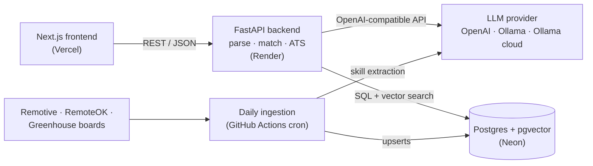

# MatchLens

[](https://github.com/sohamghodake/Match-Lens/actions/workflows/ci.yml)

Upload a resume and get ranked remote jobs, each with a fit score, the reason it matched and the skills you're missing, plus an ATS score against any job description you paste.

Next.js + TypeScript frontend, FastAPI backend, Postgres + pgvector, and any OpenAI-compatible LLM: OpenAI, local Ollama, or Ollama cloud.



## Status

| Phase | State |
| --- | --- |
| 0 · Skeleton: compose, health check, CI | ✅ done |
| 1 · Data model + LLM layer | ✅ done |
| 2 · Resume parsing | ✅ done |
| 3 · Job ingestion | ✅ done |
| 4 · Matching | ✅ done |
| 5 · ATS scoring | next |
| 6 · Evaluation + tests | |
| 7 · Deployment + demo polish | |

## Run it locally

Needs Docker. Ports default to 3100 (web), 8100 (API) and 5440 (Postgres); change them in `.env` if they clash.

```bash
cp .env.example .env    # then pick an LLM provider and add its key
docker compose up --build
```

Open http://localhost:3100 and drop in a PDF or DOCX resume; you land on `/resume/<id>` with the parsed profile. http://localhost:3100/status should say **API healthy** and **Database connected**. Migrations run automatically when the backend container starts.

Run the tests, lint and LLM smoke check inside the backend container:

```bash
docker compose exec backend pytest -q                      # DB tests run against the compose db
docker compose exec backend sh -c 'ruff check . && ruff format --check .'
docker compose exec backend python -m scripts.smoke_llm --embeddings
docker compose exec frontend sh -c 'npm run lint && npm run typecheck'
```

`RUN_SLOW=1 pytest` also loads the local embedding model.

## Job ingestion

```bash
docker compose exec backend python -m ingestion.run              # fetch all sources, store
docker compose exec backend python -m ingestion.run --dry-run    # fetch and classify only
docker compose exec backend python -m ingestion.run --save-raw /tmp/raw   # keep the feeds,
docker compose exec backend python -m ingestion.run --replay /tmp/raw     # then rerun offline
```

Three free sources: [Remotive](https://remotive.com) and [Remote OK](https://remoteok.com) public APIs, and the public Greenhouse job-board API for 29 companies with remote roles (`backend/ingestion/scrapers/greenhouse.py`). Both job boards require a followed link back to the listing and naming them as the source, so every job keeps its source URL. Remotive also asks for at most 4 requests a day, so a run makes one request and filters locally.

In production, `.github/workflows/ingest.yml` runs this daily on GitHub Actions once a `DATABASE_URL` secret is set (Phase 7).

First runs, 6 Nov 2026 (local Postgres):

| | Run 1 | Run 2 |
| --- | --- | --- |
| Fetched | 6,476 | 6,476 |
| Kept (remote tech roles) | 1,491 | 1,491 |
| Inserted | 1,487 | **0** |
| Unchanged | 0 | 1,487 |
| Cross-source duplicates skipped | 4 | 4 |
| Time | 4 min 16 s (embeds everything) | 54 s |

Rows afterwards: 1,487 jobs, 1,487 distinct `(source, source_id)` pairs, 1,487 distinct content hashes, none missing an embedding. Remotive's free API exposes only 12 jobs, so Greenhouse supplies about 96% of them.

**Could a free local LLM extract job skills?** `python -m eval.job_skills_eval` compares the dictionary scan with a model on stored jobs. With qwen2.5:3b on this machine's CPU, on 8 jobs:

| Prompt | Time per job | Skills added | Actually in the text | Dictionary skills it missed |
| --- | --- | --- | --- | --- |
| First version | 22 s | 43 | 5 (12%): it mostly echoed the prompt's category names | 28 |
| With an example answer | 14 s | 10 | 4 (40%) | 19 |

So the pipeline uses the dictionary only. `--llm-skills` stays available for a stronger local model; it keeps only additions that the description actually mentions.

## Matching

`GET /resumes/{id}/matches` (UI: **Find matching jobs** on a parsed resume) returns the 20 best remote jobs, each with a 0–100 fit score, a one-line reason, the skills you have, and the ones you're missing. Optional filters: `posted_within_days` and `seniority` (repeatable). Results are cached per resume and filter set for 12 hours; `refresh=true` recomputes them.

```bash
docker compose exec backend python -m scripts.match_bench RESUME_ID -p groq -p groq=openai/gpt-oss-20b
docker compose exec backend python -m scripts.reparse_resumes   # after parser changes
```

End-to-end latency on one real resume (a student) against 1,460 active jobs, 6 Nov 2026:

| Re-rank model | Total | Database retrieval | AI re-rank | Tokens | Top result |
| --- | --- | --- | --- | --- | --- |
| Groq `openai/gpt-oss-120b` (default) | 2.4 s | 28 ms | 2.4 s | 3,481 | Software Engineer Intern (85) |
| Groq `openai/gpt-oss-20b` | 1.5 s | 16 ms | 1.4 s | 3,393 | Research Engineer; the intern role isn't in its top 5 |
| Local `qwen2.5:3b` (CPU) | 275 s | 14 ms | 275 s | 3,090 | a *Senior* ML Engineer role, for an intern |

A cached repeat takes about 15 ms. Ranking quality (precision@10 for vector-only, hybrid, and hybrid + re-rank) is measured in Phase 6.

## Parser evaluation

`backend/eval/samples/` holds five fictional resumes with ground-truth labels, generated by `python -m eval.make_samples` so the labels can't drift from the files. They cover one- and two-column PDFs, a table-layout DOCX, contact details in a page header, company-first lines, five date formats and skill aliases.

```bash
docker compose exec backend python -m eval.parse_eval                          # score all samples
docker compose exec backend python -m eval.parse_eval --file eval/private/me.pdf  # print one parse
```

Put real resumes in `backend/eval/private/`, which is gitignored.

Results on the five samples, 6 Nov 2026:

| Metric | gpt-oss:120b (Ollama cloud, paid) | qwen2.5:3b (local CPU, free) |
| --- | --- | --- |
| Roles found | 15/15 | 15/15 |
| Title / company / start / end accuracy | 100 / 100 / 100 / 100% | 100 / 93 / 100 / 100% |
| Exit check (no missing roles or dates) | Pass | Pass (an earlier run passed 4/5) |
| Skills recall (labeled must-haves) | 100% | 100% |
| Seniority matching the label | 4/5 | 1/5, or 2/5 with the title-level rule |
| Parse time per resume | 4–6 s | 35–63 s |

Before the robustness fixes in the Phase 2 design notes, qwen2.5:3b scored 50% overall: 20% of end dates, and 2 of 5 resumes fell back to rules. The local default is qwen2.5:3b because it's free. gpt-oss:120b is billed per token; all the runs above used roughly 100k tokens, about $0.03 at list price.

Five synthetic resumes don't make an accuracy claim; Phase 6 measures 30–50 real ones.

## Switching LLM provider

The backend uses one OpenAI SDK client for every provider, so switching is three variables in `.env`:

| Provider | `LLM_BASE_URL` | `LLM_API_KEY` | `LLM_MODEL` | Cost |
| --- | --- | --- | --- | --- |
| Ollama (local, default) | `http://host.docker.internal:11434/v1` | any non-empty string | `qwen2.5:3b` | Free; CPU-only here, slow |
| Groq | `https://api.groq.com/openai/v1` | key from console.groq.com/keys | see `scripts.provider_info` | Free tier: rate-limited, no card |
| Ollama cloud | `https://ollama.com/v1` | key from ollama.com/settings/keys | `gpt-oss:120b` | Billed per token, no free allowance |
| OpenAI | `https://api.openai.com/v1` | OpenAI key | `gpt-5.4-mini` | Depends on your account's free allowance |

`LLM_MODEL_FAST` (optional) is used for cheap bulk calls such as skill extraction during ingestion.

To list the models a key can use and its rate limits (one tiny request per probed model):

```bash
docker compose exec backend python -m scripts.provider_info groq --probe openai/gpt-oss-120b
```

To compare providers side by side, set `GROQ_API_KEY`, `OPENAI_API_KEY` and/or `OLLAMA_API_KEY` and run:

```bash
docker compose exec backend python -m scripts.smoke_llm --all
docker compose exec backend python -m scripts.smoke_llm -p ollama-cloud -p openai=gpt-5.4-mini
```

Each line reports whether the JSON validated, whether the repair retry was needed, latency and token counts. The script exits non-zero if any provider fails.

## Design notes

**Phase 0: skeleton**

- The browser calls FastAPI directly (`NEXT_PUBLIC_API_URL`), as it will in production on Vercel → Render, so CORS is configured from day one and only listed origins get CORS headers.
- `/health` never touches the database. Render polls it, and a query on every poll would keep Neon's free compute awake around the clock (100 compute-hours a month is about 3 hours a day). `/health/db` is the deep check: database reachable, pgvector version, current migration.
- One backend Dockerfile serves both compose (dev dependencies, bind mount, `--reload`) and Render (`$PORT`, non-root user).

**Phase 4: matching**

- **Three stages, as planned:** pgvector cosine search for the 100 nearest active jobs; a hybrid score (0.55 × normalized similarity + 0.45 × the share of the job's listed skills you have, minus a seniority-gap penalty); then one LLM call that scores the top 20 with a reason each.
- **Sized for Groq's free tier** (8,000 tokens per minute, hidden reasoning included). The plan's re-rank call sent full descriptions (10–15k tokens). Instead each job is a compact card (title, level, up to 12 skills, and a 280-character excerpt that skips company boilerplate by starting at "Requirements", "What you'll do" and similar headings), and `reasoning_effort=low` keeps gpt-oss's thinking short. A real call uses about 3,500 tokens.
- **Re-ranking is optional at run time.** On a rate limit or any LLM error you get the hybrid ranking with rule-based reasons ("You have 4 of its 7 listed skills…") and a notice. That result isn't cached, so the next request tries the model again.
- **pgvector details:** an HNSW scan returns at most `hnsw.ef_search` rows (40 by default) whatever the `LIMIT`, so it's raised to 250, with `iterative_scan = relaxed_order` on pgvector 0.8+ so filtered queries still fill the list. Only jobs embedded by the same model as the resume are compared.
- **Seniority:** jobs well above your level are penalized (−0.25 for two or more levels up, −0.08 for one); jobs whose title states no level aren't. The level filter keeps those unlevelled jobs.
- **One entry per company and title.** Greenhouse posts a role once per location, which would otherwise fill several of the 20 slots.
- **"Missing skills" must be real skills**: listed by the job or known to the dictionary, and not already yours. The model had suggested "Leadership", and listed Docker for someone who has Docker.
- **Projects are part of the profile.** For students they're most of the signal; your Hive and Ironwork projects moved Go/PostgreSQL/LLM roles up the list.
- **Identical concurrent requests make one AI call** (a per-resume, per-filter lock), so double-clicks and second tabs don't spend the token budget twice.
- **Fixed along the way in ingestion:** annotation and "AI trainer" gigs are excluded; garbled text from Remote OK's feed (`â\x80\x99` for `’`) is repaired; and stored jobs that a changed filter now rejects are deactivated instead of lingering.
- **Known gap: location eligibility.** Most remote roles are restricted ("Remote, US", "Remote – Brazil"), and matching doesn't yet know where you can work.

**Phase 3: job ingestion**

- **No LLM in the pipeline, so it costs nothing.** Skills come from the same alias dictionary the resume parser uses. Ambiguous names count only inside a skill list: "Python, Go or Rust" yields Go, but "Go-to-market" doesn't, and "R&D" isn't the R language. An optional LLM pass (`--llm-skills`, capped per run) can add skills from a local model, but qwen2.5:3b invented more than it found (measurements above), so it's off.
- **Remote OK tags aren't used as skills.** Its tags are noisy: an "AI Engineer" job tagged "customer support" and "exec", and only 77% of skill-like tags appear in the job text.
- **Tech roles are chosen by title, not description.** A sales job at a software company mentions engineering all the time. A clearly technical title beats a department word ("Data Scientist, Marketing" is kept; "Sales Engineer" isn't). An audit of 40 dropped titles found one wrong drop, which was fixed.
- **Remote means the location says so**: remote, distributed, anywhere, work from home. Country-only locations ("United States") don't count, except for companies configured as distributed by default, such as Elastic.
- **Two kinds of de-duplication.** The upsert key is `(source, source_id)`; the content hash decides "unchanged" (refresh `last_seen_at`) versus "changed" (update and re-embed). Across sources, the same content hash or the same normalized company and title counts as one job, so a posting cross-listed on Remotive and Remote OK is stored once.
- **Closed jobs are detected only where the feed can prove it.** Remotive and each Greenhouse board list every open job, so a job missing from a successfully fetched scope is marked inactive. A board that fails to fetch never deactivates anything. Remote OK shows only its latest ~100 posts, so its jobs expire 30 days after posting instead, and older posts still in its feed aren't stored at all. (The plan said "older than 30 days → inactive" everywhere; for Greenhouse that would hide jobs that are still open.)
- **Each run is one transaction and is always logged**, with per-source counts and errors in `ingestion_runs`, so a broken source shows up without failing the run. Only "no source could be fetched" exits non-zero. The run also deletes expired resumes, since Render's sleeping API can't be relied on for that.

**Phase 2: resume parsing**

- **The LLM extracts; code computes.** The model copies titles, companies and dates as written. Code normalizes the dates (`Sept 2024`, `03/2021`, `2019`, `Present` all become `YYYY-MM` / `YYYY` / `present`), maps skill aliases (`JS` → JavaScript, `k8s` → Kubernetes), and computes total experience by merging overlapping date ranges and leaving out internships. LLMs are unreliable at date arithmetic, and this keeps the number deterministic and testable.
- **Contact details never leave the upload handler.** Emails and phone numbers are replaced with `[email]` / `[phone]` before the text goes to the LLM or the database. What's kept is whether they were present, which Phase 5's ATS check needs. The phone regex skips runs of years like `2019 – 2021`. Names stay in the text; reliable name removal is a much harder problem.
- **Two-column PDFs are read column by column.** pdfplumber reads straight across the page, which interleaves a sidebar with the main column. The extractor looks for a vertical gutter and reads each side separately, with any full-width header first. It only splits when each side holds at least 15% of the text, because single-column resumes with right-aligned dates also have a gap down the page, and splitting those would separate every title from its dates.
- **File type comes from the bytes**, not the filename or Content-Type. Legacy `.doc`, scanned (image-only) PDFs and corrupt files each get a specific message. Requests over 6 MB are rejected from the `Content-Length` header before the body is read.
- **Small models get help, and none of it costs a strong model anything.** Switching to the free qwen2.5:3b dropped accuracy to 50%. Three deterministic fixes brought it to 98%:
  - **Seniority** is accepted in any case and common synonyms ("Senior", "Mid-level", "Staff" → lead).
  - **The schema in the prompt is flattened** (`$ref`s inlined, metadata titles dropped); the 3B model had copied `$defs` plumbing into its answers.
  - **Missing dates are recovered from the text.** The model found the roles but dropped their dates, so code finds each role's line in the resume and takes the date range on it or just below. It never overrides a date the model gave, and "Engineer" doesn't match an "Engineer II" line.
- **An explicit level in the latest title wins** ("Senior …", "Staff …", "… Intern"); the model judges seniority only when the title doesn't say.
- **The LLM gets its own `location` field.** Asked to copy "Zentrix Technologies, Bengaluru" as written, gpt-oss put the city in the company name for 5 of 15 roles. Giving it a place for the location fixed all 5.
- **If the LLM fails, rules take over:** dictionary skill search (ambiguous names like Go, R and Spring are skipped), seniority from the most recent title, then years. The profile says it was rule-based, and the upload still succeeds.
- **24-hour retention has two layers.** Reads ignore resumes older than 24 hours, and an hourly sweep deletes them. Render's free tier sleeps, which pauses the sweep, so the read filter is what guarantees nothing older is served. Users can also delete immediately.
- **The resume is embedded as a compact summary** (headline, seniority, skills, role titles), not its raw text, which bge-small would cut off at 512 tokens.

**Phase 1: data model and LLM layer**

- **Every vector is 384-d.** bge-small-en-v1.5 is natively 384-d and OpenAI's `text-embedding-3-small` accepts `dimensions=384`, so changing `EMBED_PROVIDER` never changes the schema. `embed_model` is stored next to each vector because vectors from different models aren't comparable; switching means re-embedding.
- **Resumes and jobs are embedded the same way, for now.** bge recommends an instruction prefix for short search queries, but a resume against a job description is long text on both sides, and fastembed adds no prefix for bge-small. The embedder still has separate `embed_query` and `embed_documents` methods, so the prefix can be A/B-tested on precision@10 in Phase 6.
- **The local embedding model is baked into the Docker image.** Render's disk is wiped on every cold start, and downloading about 70 MB on each wake-up would make a slow start slower.
- **Structured output uses JSON mode plus Pydantic, not strict `json_schema`**, because Ollama documents JSON mode but not strict schemas. The schema goes into the system prompt; on a validation failure the model sees its own reply and the error once, and after that the caller gets an `LLMError` and uses a rule-based fallback. Provider errors (bad key, unknown model, `insufficient_quota`) are not retried, since retrying can't fix them.
- **HNSW index (cosine, m=16, ef_construction=64).** Unlike IVFFlat it doesn't need training data, so it works on an empty table that fills up daily.
- **Neon URLs work as pasted.** `postgresql://…?sslmode=require` is rewritten for asyncpg, which rejects libpq-only parameters. Use the direct (non-pooler) connection string; asyncpg's prepared statements don't work through PgBouncer in transaction mode.
- Columns beyond the plan's list (`is_active`, `seniority`, `first_seen_at`/`last_seen_at`) are there for Phase 3 (expiring stale jobs) and Phase 4 (seniority filter and penalty), to avoid a migration mid-project.
- CI runs the migrations against a real pgvector Postgres and then `alembic check`, which fails if the models and migrations drift apart.

## Repo layout

```text
backend/
  app/api/          routes: health, resumes, matches
  app/core/         settings, logging
  app/db/           models, session, Alembic migrations
  app/llm/          LLMClient, embedding providers, provider presets
  app/parsing/      extraction, redaction, dates, skills, seniority, parse service
  app/matching/     retrieve (pgvector), score (hybrid), rerank (LLM), service, schema
  ingestion/        scrapers/ (remotive, remoteok, greenhouse), normalize, dedupe, store, run
  eval/             sample resumes + labels, parser evaluation, job-skill comparison
  scripts/          smoke_llm, provider_info, match_bench, reparse_resumes
  tests/
frontend/           Next.js 16 app (app/, components/, lib/api.ts)
.github/workflows/  ci.yml, ingest.yml (daily cron)
docker-compose.yml  db, backend, frontend, optional ollama (--profile ollama)
```
