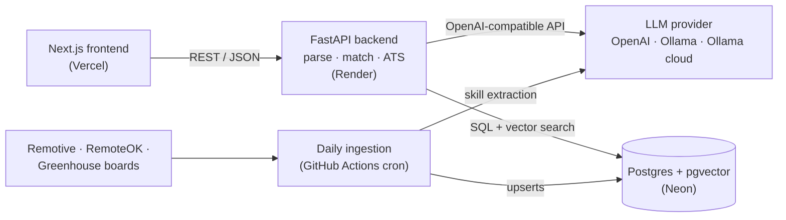

# MatchLens

Upload a resume and get ranked remote jobs, each with a fit score, the reason it matched and the skills you're missing, plus an ATS score against any job description you paste.

Next.js + TypeScript frontend, FastAPI backend, Postgres + pgvector, and any OpenAI-compatible LLM: OpenAI, local Ollama, or Ollama cloud.



## Status

| Phase | State |
| --- | --- |
| 0 · Skeleton: compose, health check, CI | ✅ done |
| 1 · Data model + LLM layer | ✅ done |
| 2 · Resume parsing | next |
| 3 · Job ingestion | |
| 4 · Matching | |
| 5 · ATS scoring | |
| 6 · Evaluation + tests | |
| 7 · Deployment + demo polish | |

## Run it locally

Needs Docker. Ports default to 3100 (web), 8100 (API) and 5440 (Postgres); change them in `.env` if they clash.

```bash
cp .env.example .env    # then pick an LLM provider and add its key
docker compose up --build
```

Open http://localhost:3100. The status card should say **API healthy** and **Database connected**. Migrations run automatically when the backend container starts.

Run the tests, lint and LLM smoke check inside the backend container:

```bash
docker compose exec backend pytest -q                      # DB tests run against the compose db
docker compose exec backend sh -c 'ruff check . && ruff format --check .'
docker compose exec backend python -m scripts.smoke_llm --embeddings
docker compose exec frontend sh -c 'npm run lint && npm run typecheck'
```

`RUN_SLOW=1 pytest` also loads the local embedding model.

## Switching LLM provider

The backend uses one OpenAI SDK client for every provider, so switching is three variables in `.env`:

| Provider | `LLM_BASE_URL` | `LLM_API_KEY` | `LLM_MODEL` |
| --- | --- | --- | --- |
| Ollama cloud | `https://ollama.com/v1` | key from ollama.com/settings/keys | `gpt-oss:120b` |
| OpenAI | `https://api.openai.com/v1` | OpenAI key | `gpt-5.4-mini` |
| Ollama (local) | `http://host.docker.internal:11434/v1` | any non-empty string | `qwen2.5:7b` |

`LLM_MODEL_FAST` (optional) is used for cheap bulk calls such as skill extraction during ingestion.

To compare providers side by side, set `OPENAI_API_KEY` and/or `OLLAMA_API_KEY` and run:

```bash
docker compose exec backend python -m scripts.smoke_llm --all
docker compose exec backend python -m scripts.smoke_llm -p ollama-cloud -p openai=gpt-5.4-mini
```

Each line reports whether the JSON validated, whether the repair retry was needed, latency and token counts. The script exits non-zero if any provider fails.

## Design notes

**Phase 0: skeleton**

- The browser calls FastAPI directly (`NEXT_PUBLIC_API_URL`), as it will in production on Vercel → Render, so CORS is configured from day one and only listed origins get CORS headers.
- `/health` never touches the database. Render polls it, and a query on every poll would keep Neon's free compute awake around the clock (100 compute-hours a month is about 3 hours a day). `/health/db` is the deep check: database reachable, pgvector version, current migration.
- One backend Dockerfile serves both compose (dev dependencies, bind mount, `--reload`) and Render (`$PORT`, non-root user).

**Phase 1: data model and LLM layer**

- **Every vector is 384-d.** bge-small-en-v1.5 is natively 384-d and OpenAI's `text-embedding-3-small` accepts `dimensions=384`, so changing `EMBED_PROVIDER` never changes the schema. `embed_model` is stored next to each vector because vectors from different models aren't comparable; switching means re-embedding.
- **Resumes and jobs are embedded the same way, for now.** bge recommends an instruction prefix for short search queries, but a resume against a job description is long text on both sides, and fastembed adds no prefix for bge-small. The embedder still has separate `embed_query` and `embed_documents` methods, so the prefix can be A/B-tested on precision@10 in Phase 6.
- **The local embedding model is baked into the Docker image.** Render's disk is wiped on every cold start, and downloading about 70 MB on each wake-up would make a slow start slower.
- **Structured output uses JSON mode plus Pydantic, not strict `json_schema`**, because Ollama documents JSON mode but not strict schemas. The schema goes into the system prompt; on a validation failure the model sees its own reply and the error once, and after that the caller gets an `LLMError` and uses a rule-based fallback. Provider errors (bad key, unknown model, `insufficient_quota`) are not retried, since retrying can't fix them.
- **HNSW index (cosine, m=16, ef_construction=64).** Unlike IVFFlat it doesn't need training data, so it works on an empty table that fills up daily.
- **Neon URLs work as pasted.** `postgresql://…?sslmode=require` is rewritten for asyncpg, which rejects libpq-only parameters. Use the direct (non-pooler) connection string; asyncpg's prepared statements don't work through PgBouncer in transaction mode.
- Columns beyond the plan's list (`is_active`, `seniority`, `first_seen_at`/`last_seen_at`) are there for Phase 3 (expiring stale jobs) and Phase 4 (seniority filter and penalty), to avoid a migration mid-project.
- CI runs the migrations against a real pgvector Postgres and then `alembic check`, which fails if the models and migrations drift apart.

## Repo layout

```text
backend/
  app/api/          routes (health so far)
  app/core/         settings, logging
  app/db/           models, session, Alembic migrations
  app/llm/          LLMClient, embedding providers, provider presets
  scripts/          smoke_llm.py
  tests/
frontend/           Next.js 16 app (app/, components/, lib/api.ts)
.github/workflows/  ci.yml
docker-compose.yml  db, backend, frontend, optional ollama (--profile ollama)
```
